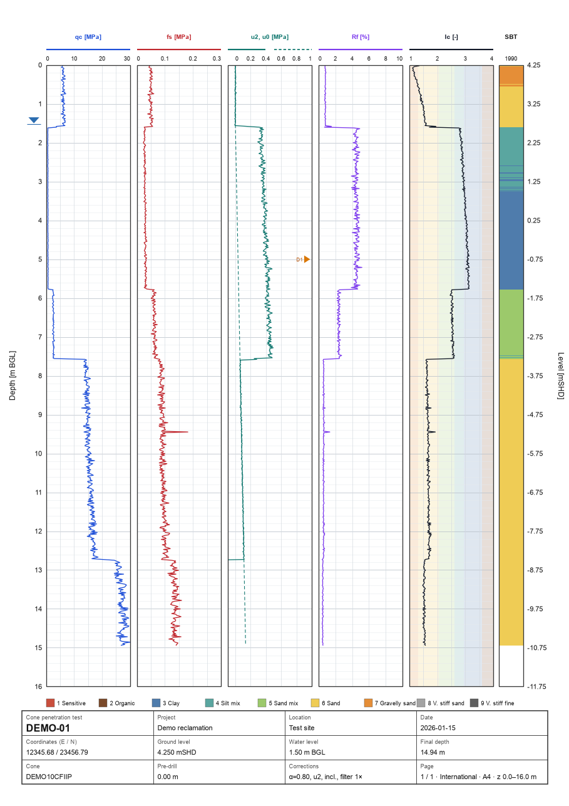
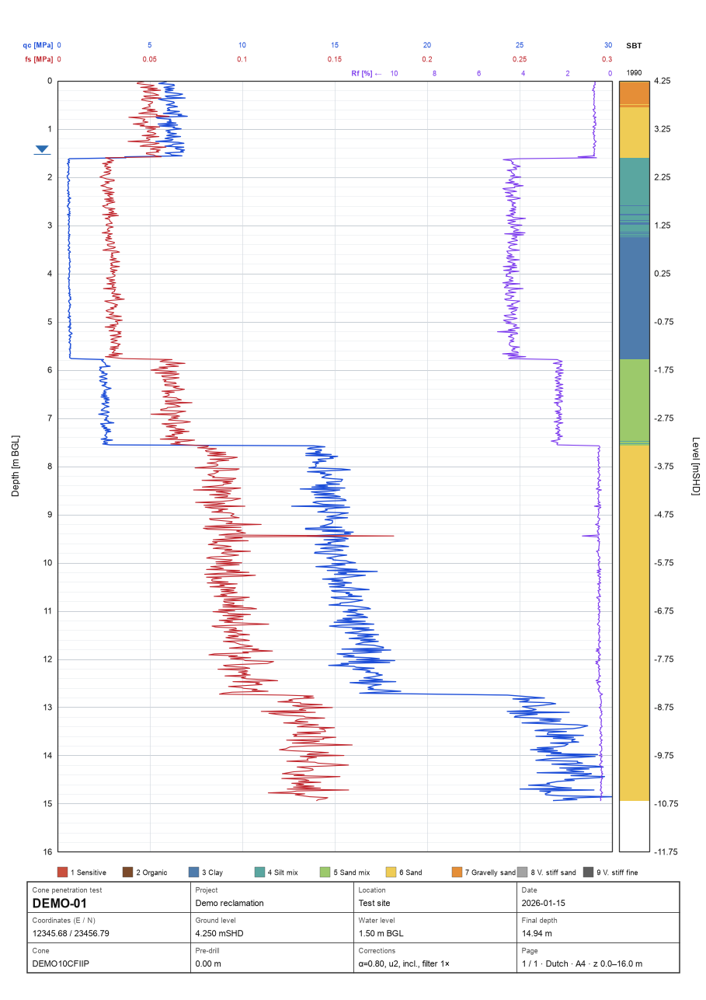
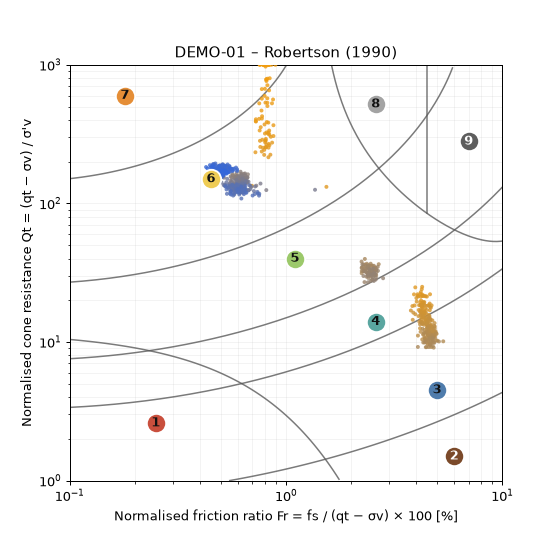
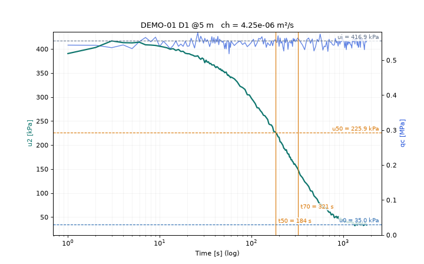
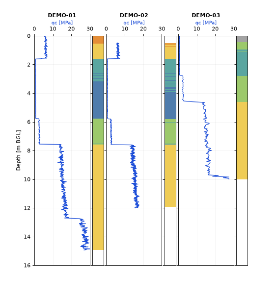

# CPT Analyser – Python

**Cone penetration test (CPT / CPTu) reader and interpreter in plain Python.**
It is the Python version of the single-file browser tool
[CPT Analyser (HTML)](https://github.com/balajisaikumarbandaru/cpt-analyser). It uses the same equations, the same
processing steps and the same settings files, and it gives the same numbers. Use it when you want to:

- process a whole folder of soundings in one command (PDF logs, Excel, CSV, layer tables)
- use CPT data in your own scripts or Jupyter notebooks (everything is a pandas DataFrame)
- **change the calculations yourself** – every step is a short, readable Python function



> All images use synthetic demo data from `tools/make_demo_data.py`.

---

## Install

Python 3.10 or newer.

```bash
git clone https://github.com/balajisaikumarbandaru/cpt-analyser-python.git
cd cpt-analyser-python
python -m venv .venv && source .venv/bin/activate      # Windows: .venv\Scripts\activate
pip install -e ".[app]"                                # without the browser app: pip install -e .
```

`-e` (editable) means that changes you make to the code take effect immediately – no re-install needed.

## Three ways to use it

### 1. Command line

```bash
cpt-analyser info  path/to/gef_folder
cpt-analyser export path/to/gef_folder -o out              # PDF of all logs + CSV per CPT + layer table
cpt-analyser export path/to/gef_folder -o out --all        # + PNG pages, Robertson chart, Excel, GEF, combined CSV
cpt-analyser export CPT01.gef -o out --pdf --settings site.cptset.json
cpt-analyser settings site.cptset.json                     # write the default settings, edit, pass with --settings
```

### 2. Browser app (no coding)

```bash
streamlit run app/streamlit_app.py
```

Upload files, change factors in the sidebar, look at the log / SBT chart / layers / data, correct readings, compare
soundings and download every export.

### 3. Python

```python
import cpt_analyser as ca

col = ca.load("data/")                      # files or folders: GEF, GME pairs, CSV, Excel, .cptset.json
cpt = col["CPT-01"]                         # or col[0]
cpt.header.gwl, cpt.header.gl               # header fields
df = cpt.to_dataframe()                     # raw + derived values, one row per reading
cpt.layers_dataframe()                      # soil layers with mean qc, fs, Rf, Ic, Dr, φ', Su, N60

col.settings.factors["gwlDefault"] = 2.0    # change any factor …
col.process()                               # … and recalculate everything

ca.plot_log(cpt, page=0).savefig("CPT-01.png", dpi=200)
ca.save_log_pdf(col.cpts, "all.pdf", collection=col)
ca.to_excel(cpt, "CPT-01.xlsx")
ca.save_gef(cpt, "CPT-01.gef")              # original layout kept; only edited values change
```

See [`examples/quickstart.py`](examples/quickstart.py) for a complete tour.

---

## What it does

| | |
|---|---|
| **Input** | GEF-CPT (qc, fs, u1/u2/u3, inclination resultant or X/Y, time, corrected depth, any extra column), GEF-DISS dissipation tests, GME raw data (`.0xx` header + `.1xx` data, converted with the calibration factors), Excel (CPTask-style Header/Data sheets or any table), CSV/TXT, settings files (`<name>.cptset.json` applies to the CPT with that name) |
| **Processing** | spike filter, fs shift to cone depth (automatic for raw GME), inclination depth correction, pre-drill, selectable pore-pressure filter |
| **Derived** | Rf, u0, qt, Δu, qe, u/qc, γ (constant or Robertson & Cabal 2010), σv, σ′v, qn, Bq, Qt, Fr, Ic, Robertson (1990) SBT zone, Qtn and Ic,n (2009), Dr (Baldi NC/OC), φ′, Su (Nk min/max), N60, penetration rate – see [docs/EQUATIONS.md](docs/EQUATIONS.md) |
| **Layers** | runs of equal SBT zone, thin layers merged into the neighbour with the closest Ic |
| **Dissipation** | u0, ui, u50, t50, t70 (any %), ch (Teh & Houlsby 1991); parent CPT water level |
| **Plots** | printable A4/A3 log, international (any graphs, several pages, widths, depth per page) or Dutch standard, SBT column, title block, colour or black-and-white; Robertson chart; dissipation; compare (tile / overlay) |
| **Export** | CSV, combined CSV, layer CSV, Excel (Header/Data/Layers), GEF (lossless rewrite, keeps the file's encoding), PNG/SVG/PDF |

| Dutch standard | Robertson chart | Dissipation | Compare |
|---|---|---|---|
|  |  |  |  |

## Settings

Settings are three dictionaries – `factors`, `plot` and `scales` – stored as JSON (`.cptset.json`), the same format as the
HTML tool, so a file can be shared between both. Write the defaults with `cpt-analyser settings defaults.cptset.json`
and edit them. Main factors:

| key | default | meaning |
|---|---|---|
| `gwlDefault` | 1.0 | water level [m BGL] when the file has none |
| `gw`, `gDry`, `gWet` | 10, 18, 20 | unit weights [kN/m³] |
| `gammaMethod` | `const` | `const` or `rob` (Robertson & Cabal 2010) |
| `alphaDefault`, `sleeveDefault` | 0.8, 0.08 | net area ratio, cone–sleeve distance [m] when not in the header |
| `filterPasses`, `filterK` | 1, 4 | spike filter |
| `shiftFs` | `auto` | `auto` (raw GME only), `on`, `off` |
| `inclCorr` | true | depth correction for inclination |
| `uLoc` | `auto` | pore-pressure filter `u1`/`u2`/`u3` |
| `nkMin`, `nkMax` | 12, 20 | cone factors for Su |
| `drC0`, `drC1`, `drC2` | 157, 0.55, 2.41 | Baldi Dr constants |
| `phiA`, `phiB` | 0.105, 0.16 | friction angle constants |
| `icA`, `icB` | 3.47, 1.22 | Ic equation constants |
| `soilLimit` | true | Dr/φ′ only where Ic < 2.6, Su only where Ic ≥ 2.6 |
| `minLayer` | 0.3 | minimum layer thickness [m] |

Plot: `standard` (`intl`/`dutch`), `size` (`A4`/`A3`), `orient`, `zMin`/`zMax`/`zPage`, `tracks`
(`[{"k": "qc", "page": 1, "w": 1}, …]` – keys as in `ca.SIGNALS`), `dutch` (`l1`, `l2`, `r`), `sbt`, `grid`, `color`,
`chartColour`. Scales: `{"qc": {"min": 0, "max": 30, "log": false}, …}`.

## Code map – where to change things

```
src/cpt_analyser/
  readers/gef.py       GEF and GEF-DISS parsing (column codes, header fields)
  readers/gme.py       GME raw data conversion
  readers/tabular.py   CSV / Excel column detection
  processing.py        spike filter, fs shift, depth, all derived parameters, SBT zones, layers, dissipation
  settings.py          default factors and plot settings
  constants.py         SBT zones and colours, signal names, units and default axis ranges
  plotting.py          log page (mm layout, like the HTML), Robertson chart, dissipation, compare
  exports.py           CSV, Excel, GEF writer
  collection.py        opening many files, pairing GME files, per-CPT settings files
  cli.py               command line
app/streamlit_app.py   browser app
tools/                 demo data, HTML reference engine, comparison with the HTML tool
```

Examples: a new correlation goes into the loop in `processing.process_cpt` (add the key to the `d = {…}` dict, to
`constants.SIGNALS` to make it plottable and to `exports.data_columns` to export it). A different soil chart goes into
`processing.zone1990`.

## Same results as the HTML version

`tests/test_parity_with_html.py` checks every calculated value, the layers, the dissipation results and the GEF rewrite
against results produced by the HTML tool's own JavaScript (`tests/expected/`). The comparison tool runs the HTML engine
directly on any files:

```bash
pip install -e ".[parity]"
python tools/compare_with_html.py path/to/CPT_Analyser.html data/*.gef
```

At release it was run on 3,330 real GEF files from site work: every calculated value, layer and GEF rewrite identical.
If you change a calculation **on purpose**, change it in both tools and regenerate the expected files with
`python tools/html_reference.py path/to/CPT_Analyser.html --update-fixtures`. Known differences and open issues:
[docs/KNOWN_ISSUES.md](docs/KNOWN_ISSUES.md).

## Contributing

See [CONTRIBUTING.md](CONTRIBUTING.md). In short: branch, change, `pytest`, `ruff check .`, pull request. Never commit
real site data – the tests use synthetic files only.

## Notes

- Correlations (Dr, φ′, Su, N60, γ) are indicative and should be checked against site-specific data.
- For GME subtraction cones (cone type S) the sleeve channel is corrected with an assumed sleeve area of 15 × the tip area.
- Not included (as in the HTML version): Qt–Bq classification, GME `.Dxx` dissipation files, inclination from GME raw data.
- Not affiliated with Geomil Equipment B.V.; CPTask is their product. The equations and processing steps follow publicly
  documented methods.
